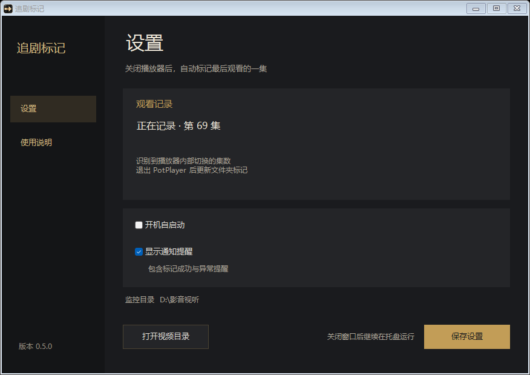
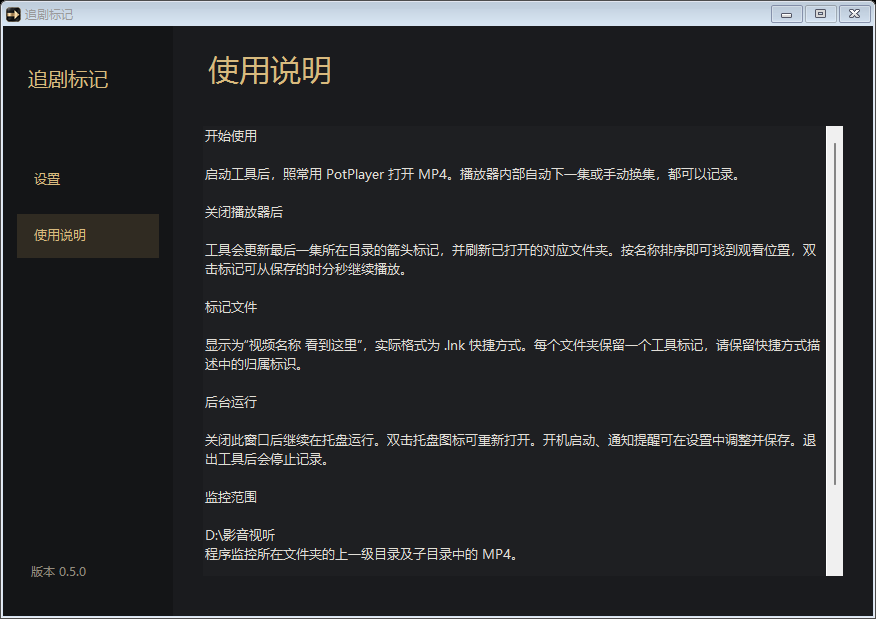

# 追剧标记 · PotPlayer Watch Marker

[](LICENSE)
[](#运行环境)
[](https://github.com/2863018802/potplayer-watch-marker/releases/latest)

关闭 PotPlayer 后，自动在视频文件夹留下“看到这里”箭头标记。下次打开文件夹，按名称排序就能找到上次观看的剧集。

**[下载 Windows 版](https://github.com/2863018802/potplayer-watch-marker/releases/latest) · [详细使用说明](使用说明.md) · [更新记录](CHANGELOG.md)**

## 功能

- 自动跟踪 MP4，支持 PotPlayer 内部连播与手动换集。
- 退出播放器后更新黑金箭头标记，每个文件夹保留一个工具标记。
- 保存具体时分秒，双击标记在 PotPlayer 新窗口继续播放，更新后自动刷新匹配的资源管理器窗口。
- 黑金设置界面，内置使用说明，支持开机自启动、通知开关和托盘运行。
- 通过归属信息保护已有用户文件，设置和观看状态保存在本机。

## 界面预览

### 设置



### 内置使用说明



截图中的剧集与路径用于演示，实际内容取决于你的文件夹和播放状态。

## 快速开始

1. 在 [Releases](https://github.com/2863018802/potplayer-watch-marker/releases/latest) 下载 Windows ZIP 包，解压到视频根目录下的独立文件夹。具体功能以该发布版本的更新记录为准。
2. 双击 `追剧标记.exe`。按需勾选开机自启动、通知提醒，点击“保存设置”。
3. 照常用 PotPlayer 打开 MP4，继续使用播放器的连播功能。
4. 关闭 PotPlayer 后，回到视频文件夹查看箭头标记。

示例目录结构如下。

```text
视频收藏/
├─ 追剧标记/
│  ├─ 追剧标记.exe
│  └─ assets/
│     └─ marker-arrow.ico
└─ 电视剧/
   ├─ S01E05.mp4
   ├─ S01E06 看到这里.lnk
   └─ S01E06.mp4
```

程序监控所在文件夹的上一级目录及其子目录。保留 EXE 与 `assets` 的相对位置。标记是 Windows 快捷方式，资源管理器通常隐藏 `.lnk` 后缀。

关闭设置窗口后，工具继续在托盘运行。双击托盘图标可打开设置，右键菜单可退出工具。

## 运行环境

- Windows 桌面环境与 .NET Framework 4。
- 已安装 PotPlayer，视频格式为 MP4。
- 当前 Windows 用户对视频目录有写入权限。

当前版本在开发电脑上完成验证，其他 Windows 版本的兼容性仍需反馈。

## 常见问题

**标记的是哪一集？**

关闭播放器前最后识别到的那一集与具体时分秒。从 0.5.0 起，新生成的标记会直接调用 PotPlayer，在新窗口从保存的位置继续播放。每秒采样，关闭瞬间可能有约一秒误差。旧标记在下一次正常观看并关闭播放器后升级。

**为什么没有生成标记？**

确认工具正在运行、视频位于监控目录内，且 PotPlayer 标题显示完整 MP4 文件名。每秒检查一次，瞬间打开并关闭的视频可能无法捕获。同名文件无法唯一定位时会暂缓标记，异常可在设置页面查看。

**标记会覆盖我的文件吗？**

工具通过归属信息识别自己的标记。同名目标被其他快捷方式占用时会提示冲突。请保留标记描述中的归属信息。

**自动刷新有什么限制？**

工具发送目录变更通知，并刷新 Windows Shell 可访问的匹配窗口。不同 Windows 版本、多标签页布局的显示效果可能不同。

**设置和日志在哪里？**

位于 `%LOCALAPPDATA%\PotWatchMarker`。`owner.txt` 识别标记归属，`sessions.json` 保存待处理记录，`settings.json` 保存通知设置，`errors.log` 记录异常。自启动使用当前用户注册表 Run 项。

## 从源码构建

下载源码后，退出正在运行的追剧标记，在项目目录执行以下命令。

```powershell
powershell -ExecutionPolicy Bypass -File .\build.ps1
```

需要 Windows 自带的 .NET Framework 4 编译器。构建后在项目目录生成 EXE，保留旁边的 `assets` 文件夹即可运行。

运行内置自测试可使用以下命令。

```powershell
& '.\追剧标记.exe' --self-test
```

结果写入 `self-test-result.txt`。自测试会临时切换自启动与通知选项，结束后恢复原设置。

## 反馈与贡献

欢迎通过 [Issues](https://github.com/2863018802/potplayer-watch-marker/issues) 反馈问题。请提供 Windows 版本、PotPlayer 版本、复现步骤与相关错误信息，上传日志或截图前移除私人文件名和路径。

## 许可证与素材

本项目采用 [0BSD](LICENSE) 许可证，允许商用、修改、再分发和闭源使用，无署名要求。软件按现状提供。

黑金箭头图标由 ImageGen 生成，原图、ICO 和生成提示词保存在 `assets` 目录中。本项目为独立开发工具，与 PotPlayer 官方无隶属关系。
